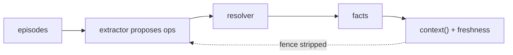

# TenseMem

**Memory that knows its tenses.** Embedded, deterministic memory that AI agents can safely act on.

One SQLite file. No server required. The model proposes typed facts; the engine decides what is current.

```bash
pip install tensemem
```

```python
from tensemem import FakeExtractor, Memory

mem = Memory(llm=FakeExtractor())
mem.register_predicate("lives_in")
added = mem.add("u1", "I live in Delhi")
ctx = mem.context(user_id="u1", min_seq=added.seq, wait=1.5)
print(ctx.text)  # fenced block the model can read
print(ctx.freshness.is_current)  # True once extract finished
```

`FakeExtractor` is rule-based and needs no API key. Same API with `tensemem[openai]`, `tensemem[anthropic]`, `tensemem[ollama]`, `tensemem[litellm]`, or Gemini (`GEMINI_API_KEY` in the process environment).

## Why this exists

Similarity search returns both “I live in Delhi” and “I moved to Bangalore” and leaves the model to guess. TenseMem keeps one current value per slot, says whether the read is fresh, and refuses to learn from its own output.

- **One current truth per ONE slot.** A new city supersedes the old one. History still answers “where did I live before?”
- **Every read reports freshness.** `as_of_seq`, `pending`, `is_current`. Wait for a message, or see that it is not applied yet.
- **No self-echo.** Recalled `context()` is fenced. Extract needs a verbatim quote from the user.
- **Corrections stick.** `correct()` restores the displaced value and survives `rebuild()` with a newer model.
- **The engine decides.** The LLM emits typed ops. Deterministic rules apply them.
- **No infrastructure.** Default store is one SQLite file inside your process.

## Delhi, then Bangalore

```python
mem.add("u1", "I live in Delhi")
mem.set(user_id="u1", predicate="lives_in", value="Bangalore")

print(mem.state("u1").values)
# {"lives_in": "Bangalore"}

history = mem.history("u1", predicate="lives_in")
# ACTIVE Bangalore, SUPERSEDED Delhi

bangalore = next(f for f in history.facts if f.object == "Bangalore")
mem.correct(bangalore.id)  # that move was never true
print(mem.state("u1").values)
# {"lives_in": "Delhi"}
```



## Architecture

Every surface is an adapter over `Memory` / `AsyncMemory`. The model proposes typed ops; `resolve()` decides mutations; `apply()` writes one SQLite file. Facts are a rebuildable projection of an append-only episode log.


Editable source: [docs/architecture.excalidraw](docs/architecture.excalidraw). File map: [Architecture](docs/architecture.md).

| If you are changing… | Start here |
|---|---|
| Python / CLI / REST / MCP API | `src/tensemem/memory.py`, `cli/main.py`, `server.py`, `mcp.py` |
| Studio UI | `studio/app/` (board, memories, playground, echo, ops) and `studio/lib/api.ts` |
| Extract prompt or worker | `pipeline/prompts/extract_v1.md`, `pipeline/worker.py`, `pipeline/extractor.py` |
| What an op is allowed to do | `core/resolver.py` (pure), `pipeline/normalize.py`, `pipeline/policy.py`, `pipeline/guard.py` |
| A new LLM or embedder | `providers/llm/`, `providers/embed/` — keys in process env only |
| SQLite schema or reads | `storage/sqlite/` (one writer; ADR 0003 / 0020) |
| Freshness, fence, corrections | `storage/sqlite/snapshot.py`, `security/fence.py`, `correct()` |
| Invariants | `tests/core/`, `tests/property/`, `tests/golden/` — default pytest never calls a hosted model |

Do not auto-register unknown predicates, skip `keep_ops`, or teach the engine from fenced `context()` text. Those are locked by tests.

## Safe to act (TenseBench)

`tensemem bench` scores the packaged 101 conversations with `FakeExtractor` (no network):

| System | Current-state accuracy | Stale-fact leak | Freshness honesty | Contamination |
|---|---:|---:|---:|---:|
| TenseMem | 1.00 | 0.00 | 1.00 | 0.00 |
| Concatenated transcript | 0.37 | 1.00 | 0.00 | n/a |
| Token-overlap retrieval | 0.37 | 1.00 | 0.00 | n/a |

Reproduce with `tensemem bench`. Methodology: [TenseBench](docs/tensebench.md).

## Inspect

```bash
tensemem inspect --user u1
tensemem history --user u1 lives_in
tensemem search --user u1 "where did I live"
tensemem serve          # HTTP on 127.0.0.1:8080
```

[TenseMem Studio](docs/studio.md) is a local Next.js inspector over `tensemem serve` (board, memories table, playground, compare, echo). It is not a chatbot. Secrets stay in the serve process environment — never in the Token field.

```bash
pip install "tensemem[server]"
tensemem --db ./studio.db serve --port 8080
cd studio && npm install && npm run dev
```

## Extras

| Extra | What you get |
|---|---|
| `tensemem[openai]` / `[anthropic]` / `[ollama]` / `[litellm]` | Hosted or local extract |
| `tensemem[server]` | `tensemem serve` REST + Studio backend |
| `tensemem[mcp]` | stdio or `tensemem mcp --http` |
| `tensemem[langgraph]` | `TenseMemStore` (`put` / `search`) |
| `tensemem[llamaindex]` | `TenseMemChatMemory` (`put` / `get`) |
| `tensemem[local]` | FastEmbed vectors for search |

Gemini extract uses `GEMINI_API_KEY` (or `GOOGLE_API_KEY`) in the environment of the process that runs extract. No extra package beyond the server if you use the built-in Gemini adapter.

`--token` / `TENSEMEM_TOKEN` is optional bearer auth on HTTP. Bind stays loopback unless you put a TLS proxy in front.

## Status

**0.1.0 alpha.** The Python API, CLI, REST, MCP, and Studio are usable on a single SQLite file. The default store is SQLite; a second SQL dialect is not shipped. Multi-tenant hosted Studio is not in this tree.

## Docs

[Quickstart](docs/quickstart.md) · [Concepts](docs/concepts.md) · [Architecture](docs/architecture.md) · [API](docs/api.md) · [CLI](docs/cli.md) · [REST](docs/server.md) · [Studio](docs/studio.md) · [MCP](docs/mcp.md) · [Operations](docs/ops.md) · [ADRs](docs/adr/)

`uvx mkdocs serve` previews the same pages locally.

## Contributing

See [CONTRIBUTING.md](CONTRIBUTING.md). `main` is protected; every change is a pull request. Merges wait until **CI**, **PR quality**, and CodeQL are green.

## License

[Apache-2.0](LICENSE)
